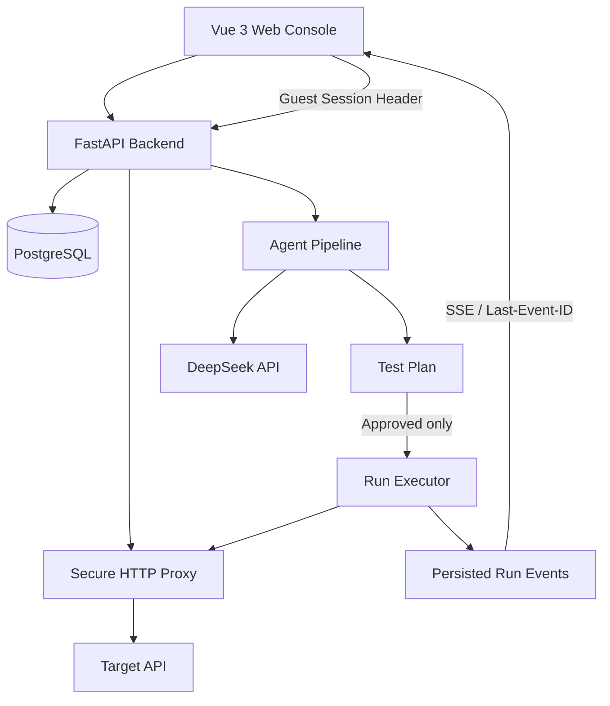

# AI API Testing Agent

[](LICENSE)
[](#已知限制与路线图)
[](https://vuejs.org/)
[](https://www.typescriptlang.org/)
[](https://fastapi.tiangolo.com/)
[](https://www.python.org/)
[](https://www.postgresql.org/)

**面向 API 开发与测试的 AI 辅助测试平台。** 支持手动发送 API 请求、解析 OpenAPI 文档、生成与审核测试计划，并通过后端执行引擎运行测试、查看断言结果与实时事件。

> **项目状态：Early Development / Alpha。** 当前已具备真实的 Guest Session、Project 管理、安全 HTTP 代理、Agent 分析与测试计划、Run 执行和 SSE 事件流等基础能力，但仍有重要限制：完整 AI 测试链路尚未通过真实浏览器端到端验收，Run 启动恢复机制尚未实现，PDF 导出尚未实现。请勿将当前版本用于关键生产测试。

## 目录

- [项目目标](#项目目标)
- [当前功能](#当前功能)
- [技术栈](#技术栈)
- [架构概览](#架构概览)
- [身份与安全边界](#身份与安全边界)
- [仓库结构](#仓库结构)
- [本地运行](#本地运行)
- [测试与验证](#测试与验证)
- [已知限制与路线图](#已知限制与路线图)
- [开发原则](#开发原则)
- [许可证](#许可证)
- [English Summary](#english-summary)
- [License](#license)

## 项目目标

AI API Testing Agent 希望把 API 测试流程整合到一个工作台中：

1. 手动调试 API 请求并查看真实响应。
2. 上传 OpenAPI 文档，让 Agent 分析接口、参数、认证方式与依赖关系。
3. 生成可审核的测试计划，由用户批准后再执行。
4. 由确定性的后端执行器发送 HTTP 请求、运行断言并保存执行结果。
5. 通过实时事件查看运行进度，并在后续迭代中完善证据和报告导出能力。

## 当前功能

### 手动 API 测试

- 支持请求方法、URL、Params、Headers、Body 与认证信息编辑。
- 通过后端 HTTP 代理发送请求，而不是让浏览器直接连接任意目标地址。
- 将目标 API 的 HTTP 4xx/5xx 响应作为上游响应呈现；测试是否通过由断言规则决定，而不是仅由 HTTP 状态码决定。
- 包含目标地址校验、SSRF 防护、DNS 解析结果检查与 IP 固定、TLS 校验、禁止自动跟随重定向及请求/响应大小限制等安全措施。
- 支持 Collections 与 Request History 的基础功能；**当前数据保存在浏览器 `localStorage`，尚未接入服务端持久化**。

### OpenAPI 与 Agent

- 提供 OpenAPI 文档上传、解析和摘要展示流程。
- Agent 后端管线包含接口分析、任务状态读取、测试计划生成和审核流程。
- 测试计划以 Scenarios、Steps、Assertions 组织。
- 支持 `draft`、`in_review`、`approved`、`rejected` 等计划状态；未批准的计划会被后端执行入口拒绝。
- 已实现 DeepSeek 客户端调用路径，但**真实模型调用尚未完成成功的端到端验收**；当前大量管线验证使用 stub 模型结果。

### 测试执行与结果

- 后端 Run Executor 负责执行 HTTP 请求、处理环境变量与运行时提取值，并评估断言。
- 当前支持 `status`、`header`、`field` 等常用断言类型；`schema` 断言尚未实现，执行时会被跳过。
- 保存 Run、Scenario、Step、Assertion、事件及部分执行证据。
- 通过 SSE 推送运行事件，并支持使用 `Last-Event-ID` 进行断线续传。
- 前端可查看 Run 列表、详情、步骤状态、断言结果和现有证据字段。

## 技术栈

| 层级 | 技术 |
|---|---|
| 前端 | Vue 3、TypeScript、Vite、Vue Router、Pinia、Element Plus、Tailwind CSS |
| 后端 | Python、FastAPI、Pydantic、SQLAlchemy、Alembic、HTTPX、asyncio |
| 数据库 | PostgreSQL |
| AI 模型客户端 | DeepSeek API（真实 provider 链路仍需进一步端到端验证） |
| 测试 | Vitest、TypeScript 类型检查、后端自定义验证脚本、受控浏览器 E2E harness |

## 架构概览



## 身份与安全边界

- 当前采用 **Guest-first** 身份模式；注册/登录属于后续独立阶段。现有登录界面仍使用 mock，不代表真实用户认证已经实现。
- 平台 API 使用 `X-Guest-Session` 传递访客身份。
- 后端按 Guest Session 校验 Project 与相关资源的访问权限。
- 目标 API 的 `Authorization` 等用户配置的请求头可按请求转发，但平台的 Guest Session 凭证不会转发到目标 API。
- HTTP 代理默认拒绝不安全的目标地址。不要将开发用的 SSRF 测试 harness 视为生产服务的目标地址白名单。

## 仓库结构

```text
.
├── backend/
│   ├── src/backend/       # FastAPI 应用：路由、服务、Schema、模型
│   │   ├── api/           #   路由与错误信封
│   │   ├── services/      #   业务逻辑（代理、Agent 管线、执行器）
│   │   ├── db/models/     #   SQLAlchemy 模型
│   │   └── prompts/       #   Agent 使用的提示词
│   ├── alembic/versions/  # 数据库迁移
│   ├── scripts/           # 后端验证脚本（verify_*.py）与开发种子数据
│   ├── dosc/              # 早期数据库与管线契约文档
│   ├── main.py            # 服务入口（uvicorn 指向它）
│   ├── pyproject.toml
│   └── uv.lock
├── docs/                  # 身份访问契约、Agent 管线契约
├── frontend/
│   ├── src/               # Vue 应用：views / components / stores / services
│   ├── tests/             # Vitest 测试（22 个 spec 文件）
│   ├── docs/              # 前端架构与后端契约文档
│   ├── package.json
│   ├── package-lock.json  # npm 锁文件
│   └── vite.config.ts
├── .gitignore
└── README.md
```

## 本地运行

### 环境准备

- Node.js 与 npm
- Python **3.12+**（以 `backend/pyproject.toml` 的 `requires-python` 为准）
- [`uv`](https://docs.astral.sh/uv/)
- PostgreSQL
- 如需启用真实模型请求，需要你自己的 DeepSeek API Key

### 1. 配置后端

创建并配置 `backend/.env`。请以当前后端配置模块要求的字段为准，至少确保 PostgreSQL 连接配置正确；真实模型调用还需要 `DEEPSEEK_API_KEY`。

**不要把 `.env`、API Key、Guest Session token 或其他凭证提交到 GitHub。**

仓库根目录与 `backend/` 的 `.gitignore` 已经屏蔽了 `.env`、`.venv/`、`__pycache__/`、
`node_modules/`、`dist/`、`.npm-cache/`、`.idea/` 与日志文件。提交前仍建议自查一次：

```powershell
git status --porcelain          # 确认没有 .env
git check-ignore -v backend/.env  # 应打印 backend/.gitignore 中的规则
```

在 `backend/` 目录中安装 Python 依赖并执行迁移：

```powershell
cd backend
uv sync
uv run alembic upgrade head
```

启动后端：

```powershell
uv run uvicorn main:app --reload
```

> `main.py` 是入口模块，它 import 的是已安装的 `backend` 包（`uv sync` 负责安装）。
> 从仓库根目录启动请用 `uv run --project backend uvicorn main:app --reload`。

如果你的本地配置使用了不同的数据库变量或启动入口，请以 `backend/pyproject.toml` 与后端配置模块为准。首次运行前请确认连接的是你自己准备的开发数据库。

### 2. 启动前端

另开一个终端：

```powershell
cd frontend
npm install
npm run dev
```

Vite 启动后，使用终端打印出的本地地址打开控制台。

## 测试与验证

在 `frontend/` 目录执行：

```powershell
npm test        # 只跑 Vitest
npm run verify  # vue-tsc 类型检查 + Vitest
```

`verify` 脚本包含 TypeScript/Vue 类型检查和 Vitest。当前已知的一次完整前端验证结果为 **22 个测试文件、300 项测试、0 失败**；这属于结项时的实测记录，不代表每次修改后都自动通过。

后端 `backend/scripts/verify_*.py` 包含多种自定义验证工具。**运行前请先阅读脚本说明及其数据库配置**：部分脚本会创建数据库夹具或 Guest Session，不应未经检查就对现有开发数据库执行。优先使用脚本明确提供的独立 scratch 数据库配置。

最近一次已知的后端九个自定义验证套件结果为 **833 项检查、0 失败**，但并非本次 README 编写时重新执行；完整后端 pytest 套件尚未运行。真实浏览器 E2E 曾对手动 API 代理核心链路完成 32/32 项检查，但完整的 OpenAPI → Agent → 计划批准 → Run → 结果主链路尚未通过真实浏览器端到端验证。

## 已知限制与路线图

当前项目仍在积极开发中。以下内容尚未完成或仍缺少充分验证：

- **Run 启动恢复：** 目前进程重启后，遗留的非终态 Run 可能停留在 `queued` 或 `running`；恢复机制尚未实现。
- **AI 全链路验证：** 真实模型调用及从文档上传到 Run 结果的完整浏览器流程尚未完成端到端验收。
- **OpenAPI YAML：** 服务端目前主要支持 JSON 格式解析，YAML 解析尚未完成。
- **PDF/报告导出：** 尚未实现。
- **Environment 管理：** 当前提供基础环境切换；新增和编辑 Environment 的完整 UI 尚未实现。
- **测试计划编辑：** 当前可编辑部分元信息并审核批准/拒绝，Scenario、Step、Assertion 的完整编辑能力尚未实现。
- **schema 断言：** 尚未实现。
- **Collections / History 持久化：** 目前仅使用浏览器本地存储，尚不支持跨设备服务端同步。
- **注册/登录：** 当前不属于 Guest-first 阶段，现有登录流程为 mock。
- **部署与 CI：** 尚无 CI 流水线与 Docker／容器化部署配置；本地启动步骤见上文。

## 开发原则

- LLM 负责分析和生成候选测试计划；HTTP 请求执行、断言判断、运行状态和事件持久化由后端确定性逻辑负责。
- 未经批准的测试计划不能执行。
- 不把目标 API 返回的 4xx/5xx 自动认定为平台错误或测试失败。
- Run 事件名、`seq` 语义、Snapshot、Event Writer 和取消状态机属于需要保持一致的契约，修改前应先审查相关文档与测试。
- 运行会修改数据库的验证脚本前，必须确认目标数据库与备份/清理策略。

## 许可证

本项目以 **MIT License** 开源发布，版权归 **PZTandKOBE** 所有。

```text
Copyright (c) 2026 PZTandKOBE
```

MIT 是宽松许可证：你可以自由使用、修改、分发本项目，包括用于商业用途，
条件是**保留版权声明与许可证全文**。完整条款见仓库根目录的 [`LICENSE`](LICENSE)。

```text
在满足上述条件的前提下，你可以：
  ✅ 商业使用      ✅ 修改源码      ✅ 分发          ✅ 私人使用

你必须：
  📌 保留版权声明与许可证副本（在副本或实质性部分中）

作者不承担：
  ⚠️ 任何形式的担保责任（软件按「原样」提供）
```

> 本项目依赖的第三方库（Vue、FastAPI、Element Plus 等）各自遵循其自身许可证，
> 不受本项目 MIT 许可证影响。若你计划再分发，请一并遵守那些许可证的要求。

---

## English Summary

**AI API Testing Agent** is an early-stage AI-assisted API testing platform built with Vue 3, TypeScript, FastAPI, and PostgreSQL. It provides a manual API client, a secured backend proxy, an OpenAPI-to-test-plan workflow, deterministic test execution, assertions, persisted run events, and SSE updates.

The project is **not production-ready yet**. Startup recovery for in-flight runs is not implemented; the complete AI workflow has not been verified end to end in a real browser; PDF export, YAML OpenAPI parsing, server-side Collections/History persistence, and real user authentication are not implemented. See the sections above for setup instructions, verification status, and current limitations.

## License

Released under the **MIT License**. Copyright (c) 2026 PZTandKOBE. See [`LICENSE`](LICENSE) for the full text — you may use, modify and redistribute this project, including commercially, provided the copyright notice and licence text are retained.
